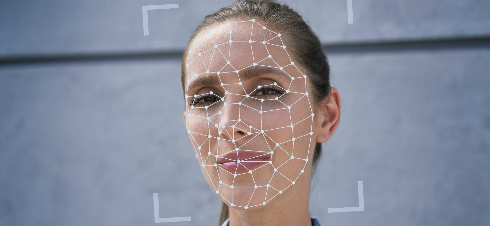
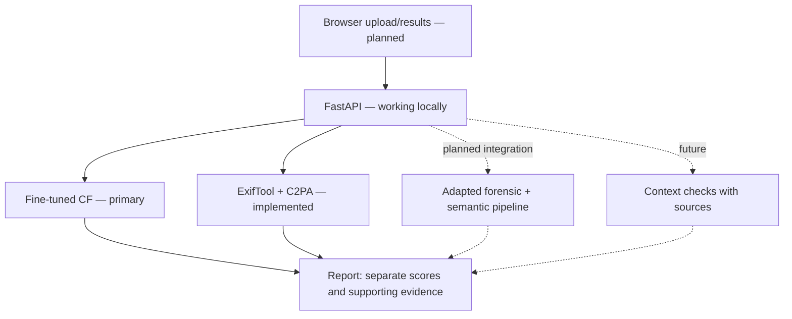
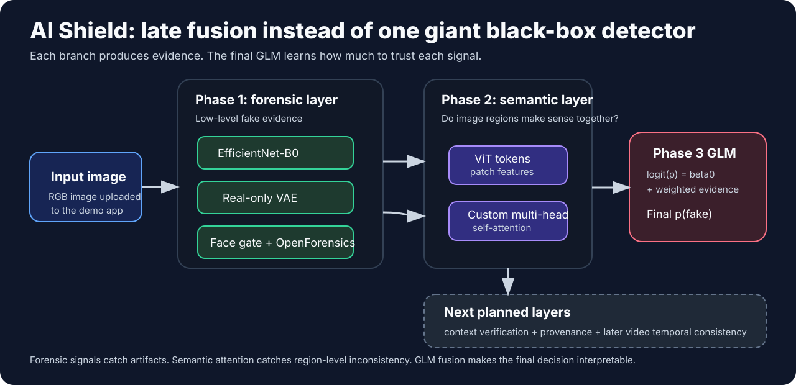
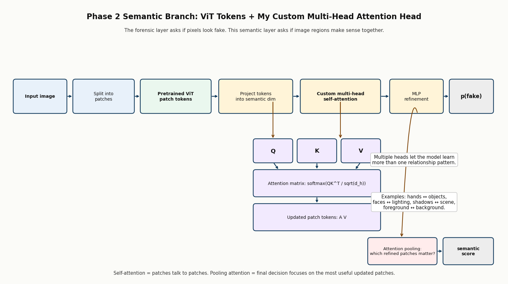
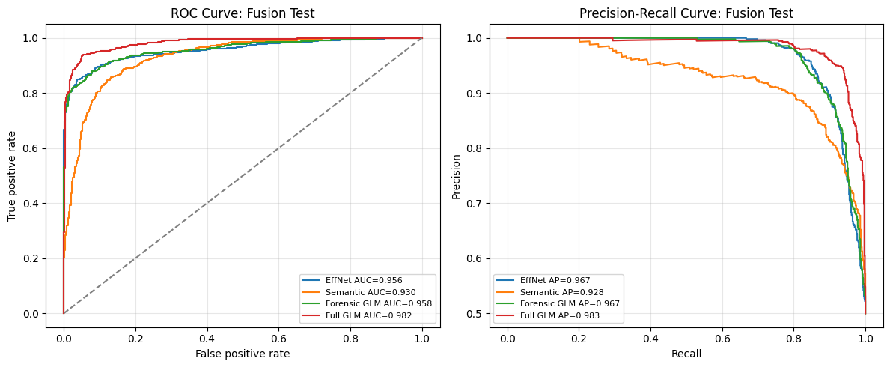
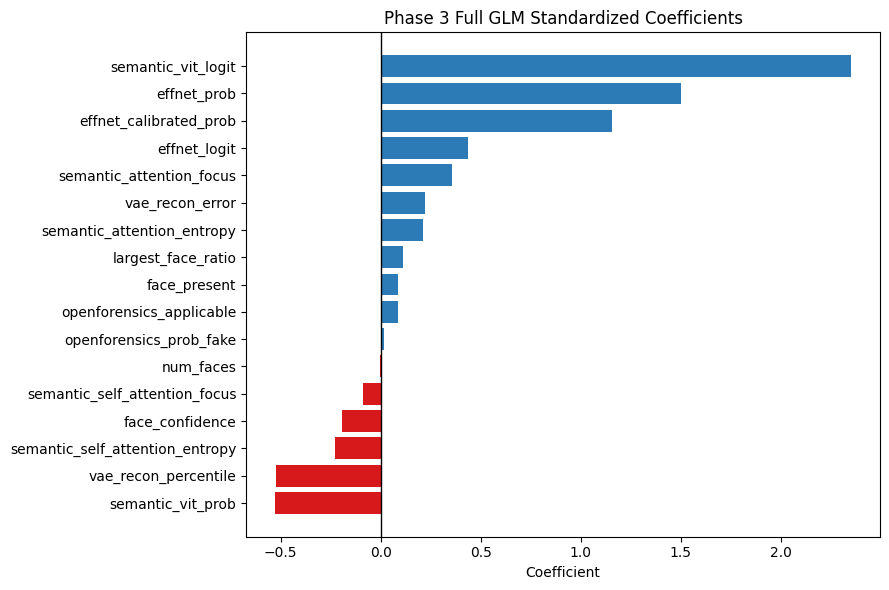
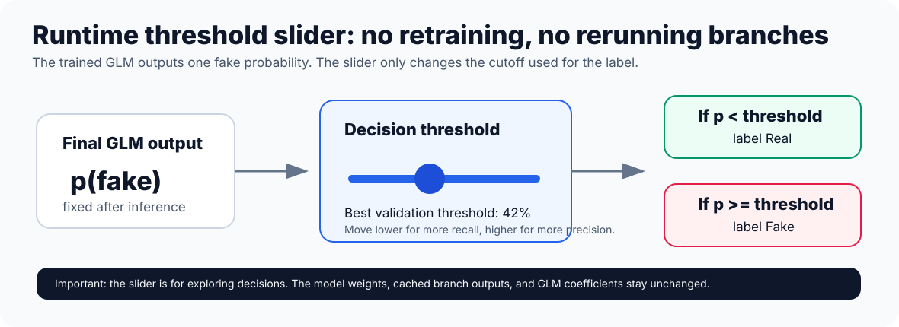

# AI Shield: Image Detection and Provenance

<p align="center">
  
</p>

AI Shield is my Computational Sciences capstone: a practical image-checking product combining machine-learning detection with available metadata and signed provenance. The goal is useful accuracy with manageable additional training and running costs. Reusing pretrained models and combining complementary signals may help, but reduced training needs or generalization to every generator have not been demonstrated.

## Current Status — October 2026

| Component | Status |
|---|---|
| Fine-tuned Community Forensics (CF) | Selected primary detector; checkpoint, preprocessing and validation threshold frozen and verified |
| Original forensic + semantic pipeline | Fine-tuned and evaluated; retained as a second detector for planned integration |
| EXIF / C2PA evidence | Implemented locally using ExifTool and the C2PA SDK; requires no training |
| FastAPI backend | Runs CF and provenance on the same upload; metadata does not change the detector score |
| Public Hugging Face demo | **Legacy fusion model**, not the current CF/provenance backend |
| New website and public deployment | Pending; hosting remains unresolved |
| Context checking / short video | Future work |

**Start here:** [Backend setup and API](docs/BACKEND.md) · [Provenance module](docs/PROVENANCE.md) · [Product design](https://docs.google.com/document/d/1vCUV068RRmIJ_LnPKz_iY6x_YcW1lcw_Dgsa3YBGGRg/edit).

### Latest Model Comparison

Both adaptations used Dataset v1: real photographs from [Open Images V7](https://storage.googleapis.com/openimages/web/download_v7.html) and generated images from [Qwen-Image-Bench](https://huggingface.co/datasets/Qwen/Qwen-Image-Bench). For the original pipeline, 2,990 training images were split into branch training (2,051), calibration (481) and fusion fitting (458), with a separate 640-image validation set. These counts do not imply identical per-model training data or compute.

| Detector | Main-test accuracy (640 images) | Held-out-generator-set accuracy (854 images) |
|---|---:|---:|
| Original saved full pipeline | 58.28% | 55.04% |
| Adapted full pipeline | 82.34% | 83.84% |
| Fine-tuned Community Forensics | **95.16%** | **96.60%** |

Source: [saved comparison report](https://drive.google.com/file/d/1DQ0WQXJqa-irn8wZ0pbbtfVkcJqs4LMP/view). The held-out generated images are from GPT-Image-2, excluded from this project's adaptation training, but not necessarily from upstream pretraining. These are different evaluation sets from the original Phase 3 results preserved below.

**Decision:** CF remains primary. Adapting the original pipeline improved its main-test accuracy by 24.06 percentage points, but it still trails CF. Three diagnostic notebooks found no clear overall improvement from simpler fusion variants. The plan is to expose both detectors separately and explain disagreements; averaging their scores is not yet justified.

### What Changed Since the Original Pipeline

1. **Adapted CF using transfer learning:** trained its decision head, then its final two transformer blocks while earlier layers stayed frozen.
2. **Froze and verified CF:** fixed its checkpoint, preprocessing and maximum-F1 threshold at `0.6339887976646423`. Six reference images reproduced their saved predictions. See [detector identity and artifact setup](docs/BACKEND.md#frozen-detector).
3. **Adapted the original full pipeline:** fine-tuned EfficientNet and the semantic heads/selected final layers, kept VAE and face models frozen, and refitted the 17-feature logistic-regression fusion. Its validation-selected threshold is approximately `0.366`.
4. **Added recorded provenance:** ExifTool reads available device, software, timestamps and optional GPS; C2PA checks embedded signed credentials, integrity and signer trust. Missing metadata means **unknown**, and editing-software metadata does not prove AI generation.
5. **Connected CF and evidence through FastAPI:** one uploaded image returns separate detection and provenance fields. The recorded CF/provenance validation run passed 38 tests plus six reference-image checks through the API; these are implementation checks, not accuracy benchmarks.

### Current and Planned Architecture



Training remains in Colab; inference loads saved checkpoints on the server. The existing semantic attention model learns visual relationships, **not historical facts or caption truth**. A future context layer may investigate contradictions with sources, but it has not been implemented or shown to improve accuracy. A low detector score or valid provenance does not certify that a depicted event is real.

### Evaluation Limits and Next Steps

- **Check source/format shortcuts:** in the held-out set, real images are JPEG and generated images are PNG. Re-encode both classes consistently, test compression/resizing, and evaluate fresh real-image sources before making broad generalization claims.
- **Measure deployment efficiency:** recorded warm A100 medians were about 23 ms/image for CF and 183 ms/image for the adapted pipeline. These include decoding/preprocessing but exclude model loading, API and provenance. The adapted semantic path repeats inputs for consistency; host-level latency, memory and cost still need measurement.
- **Integrate the second detector:** verify standalone and API outputs before exposing it beside CF.
- **Build the upload/results website:** React is the starting candidate; Next.js is optional. Oracle provisioning and Azure verification previously blocked hosting attempts, so no new public deployment is claimed.
- **Add context checks later:** test false alarms, correctness, latency and cost before using context findings in a detection decision. Short-video support follows the image product.

## Original Pipeline — Preserved Project History

The following sections document the initial image detector, its datasets, figures and deployment bundle. They remain useful for understanding how the project developed; the latest system status and comparison are above. The original stages were:

- **Phase 1: forensic evidence** from low-level visual artifacts, reconstruction error, and face-specific manipulation cues.
- **Phase 2: semantic evidence** from a ViT-based attention model that looks at how image regions relate to each other.
- **Phase 3: late fusion** with a GLM/logistic-regression meta-layer that combines both layers into one final fake probability.

The important design choice is that the final model is not one giant black-box image model. Each branch produces evidence, then the final GLM learns how much to trust each evidence source.

## Original Pipeline: Visual Overview

<p align="center">
  
</p>

This diagram describes the original pipeline. The forensic layer supplies pixel-level and face-level signals; the semantic layer learns relationships between image regions. The GLM combines their features into a classification score. Its sigmoid output is not automatically a calibrated probability.

## Main Links

| Resource | Link |
|---|---|
| Legacy deployed app — old fusion detector | <https://huggingface.co/spaces/AbdelrahmanSoliman/AI_sheild> |
| GitHub repository | <https://github.com/Abdulrahmansoliman/AI-SHEILD-MINI-CAPSTONE> |
| Notion — project progress | <https://app.notion.com/p/3d4b28a9701681b08a4ecf17f2c617d5> |
| Product design — Google Docs | <https://docs.google.com/document/d/1vCUV068RRmIJ_LnPKz_iY6x_YcW1lcw_Dgsa3YBGGRg/edit> |
| Product design — Overleaf | <https://www.overleaf.com/project/6ae0c29e81776eff66a00ba9> |
| Presentation | <https://docs.google.com/presentation/d/1JoESgiaO4YmpZz-RyHJruzWqKdzWtdqI7vRFd77VVNk/edit> |
| Community Forensics implementation | <https://github.com/JeongsooP/Community-Forensics> |
| CF experiment artifacts | <https://drive.google.com/drive/folders/1vcrWLqMnctbe9axz0qVeFuY4g72OShpj> |
| Diagnostic notebooks and outputs | <https://drive.google.com/drive/folders/1_htnscO9Pc_zuFG6WOxgFSXs0NFrHWVw> |
| Tiny-GenImage dataset | <https://huggingface.co/datasets/TheKernel01/Tiny-GenImage> |
| OpenForensics paper/dataset page | <https://openaccess.thecvf.com/content/ICCV2021/html/Le_OpenForensics_Large-Scale_Challenging_Dataset_for_Multi-Face_Forgery_Detection_and_Segmentation_ICCV_2021_paper.html> |
| Original GenImage project | <https://github.com/GenImage-Dataset/GenImage> |

## What the Legacy App Does

Upload an image and the deployed app runs:

1. **EfficientNet-B0 forensic classifier**
   - Broad real/fake image detector trained on Tiny-GenImage.
   - Produces `effnet_logit`, `effnet_prob`, and calibrated `effnet_calibrated_prob`.

2. **Real-only VAE anomaly branch**
   - Learns reconstruction behavior from real images.
   - Produces reconstruction error and reconstruction-error percentile.
   - This is an anomaly score, not a direct fake probability.

3. **Computer-vision face gate**
   - Checks whether a valid face is present.
   - Prevents the face-specific model from being trusted on images where no face exists.

4. **OpenForensics face branch**
   - Face-specific manipulation detector.
   - Only meaningful when the face gate finds a valid face.

5. **Semantic ViT attention branch**
   - Uses a pretrained ViT backbone plus my custom semantic transformer head.
   - The custom head includes multi-head self-attention, attention pooling, and a classifier.
   - Produces semantic fake probability and attention summary features.

6. **Final Phase 3 GLM fusion**
   - Combines forensic and semantic evidence into one final fake probability.
   - Also exposes the Phase 1 forensic-only GLM score so the user can compare the forensic layer against the full system.

### Semantic Attention Head

<p align="center">
  
</p>

The semantic model uses ViT patch tokens and a custom multi-head attention head so patches can interact before classification. The intention was to capture cues beyond local textures, such as inconsistent visual relationships. The architecture alone does not establish that it reliably recognizes strange hands or impossible scenes; it does not perform factual context checking.

## Original Phase 3 Test Results — Historical Benchmark

These are the saved Phase 3 test metrics from the original deployment bundle. Preserve them as results on that experiment's test split, not as current performance on Dataset v1 or arbitrary uploads.

| Model | AUC | Accuracy | Precision | Recall | F1 | Brier | Threshold |
|---|---:|---:|---:|---:|---:|---:|---:|
| EfficientNet calibrated | 0.956 | 0.903 | 0.939 | 0.861 | 0.899 | 0.078 | 0.56 |
| Semantic ViT attention | 0.930 | 0.859 | 0.840 | 0.887 | 0.863 | 0.113 | 0.64 |
| Phase 1 forensic-only GLM | 0.958 | 0.897 | 0.919 | 0.871 | 0.894 | 0.075 | 0.39 |
| Final forensic + semantic GLM | **0.982** | **0.941** | **0.943** | **0.939** | **0.941** | **0.049** | 0.42 |

On this original test split, the full fusion outperformed either branch alone. That supports combining these signals for this experiment; it does not establish why every prediction improved or guarantee the same benefit on new distributions. The newer comparison above motivated selecting CF as primary.

### Fusion Curves

<p align="center">
  
</p>

The red curve is the full forensic + semantic GLM. It gives the strongest ROC-AUC and average precision because it uses both evidence families instead of trusting one branch alone.

### What The GLM Learned

<p align="center">
  
</p>

This coefficient plot is why I like the GLM fusion layer. It is not just a black-box average. Positive coefficients push the final decision toward fake, while negative coefficients pull it back toward real after feature scaling. The model learned that both semantic evidence and forensic evidence matter, but not every branch should receive the same weight.

### Runtime Threshold Slider

<p align="center">
  
</p>

The legacy deployed app includes a threshold slider. Moving it does not retrain or rerun the models. It only changes the cutoff used to convert the score into a Real/Fake label. Its original validation-selected GLM threshold is **42%**; this is different from the adapted pipeline's approximately 36.6% and CF's approximately 63.4%.

## Dataset Choices

### Tiny-GenImage

Tiny-GenImage was the main supervised real/fake image dataset for the Phase 1 and Phase 2 branches. I intentionally kept the same dataset and split across the forensic and semantic notebooks because the goal was to test whether the semantic layer adds complementary information, not whether a new dataset changes the distribution.

Using the same dataset also makes the final fusion clean: every row in the fusion table can align the forensic evidence and semantic evidence for the same image.

### OpenForensics

OpenForensics was used for the face-specific branch. This was important because many generated or manipulated images include people, and a general image detector is not always enough for face manipulation. The deployed system uses a face gate so the OpenForensics score is only trusted when a valid face is detected.

## Repository Map

Current additions to the original layout below:

| Path | Purpose |
|---|---|
| `backend/` | FastAPI upload, detector and report pipeline |
| `src/ai_shield_cf_inference.py` | Frozen CF inference implementation |
| `src/ai_shield_provenance.py` | EXIF extraction and C2PA verification |
| `src/ai_shield_full_adaptation.py` | Original full-pipeline adaptation helpers |
| `src/ai_shield_diagnostics.py` | Branch/fusion diagnostics |
| `docs/BACKEND.md`, `docs/PROVENANCE.md` | Current setup and report contracts |
| `requirements-backend.txt`, `requirements-provenance.txt`, `requirements-adaptation.txt` | Dependencies for separate workflows |
| `tests/` | Backend, provenance, adaptation and diagnostic checks |

```text
deepfake-image-detector/
|-- README.md
|-- DEPLOYMENT.md
|-- requirements.txt
|-- streamlit_app.py
|-- deployment/
|   |-- ai_shield_app.py
|   `-- ai_shield_inference.py
|-- notebooks/
|   |-- phase1_forensic_report.ipynb
|   |-- phase2_semantic_report.ipynb
|   |-- phase3_fusion_report.ipynb
|   `-- make_ai_shield_deployment_bundle_colab.ipynb
|-- reports/
|   |-- assignment.tex
|   `-- legacy/
|-- scripts/
|   `-- extract_notebook_figures.py
|-- src/
|   |-- ai_shield_cache.py
|   |-- ai_shield_drive.py
|   |-- ai_shield_metrics.py
|   `-- ai_shield_plots.py
|-- code/
|   |-- main/
|   |-- PretrainedModel/
|   `-- results/
`-- assets/
    |-- project/
    |   `-- readme/
    `-- legacy_screenshots/
```

## Running the Current Backend Locally

Follow [docs/BACKEND.md](docs/BACKEND.md) for environment setup, ExifTool installation and the exact verified artifacts. Model weights are not included in Git; the unrelated root `best.pt` is **not** the selected CF checkpoint. Keep the current backend environment separate from the legacy TensorFlow/fusion requirements.

After completing that setup, run from the repository root:

```bash
python -m uvicorn backend.app:app --host 127.0.0.1 --port 8000
```

Open `http://127.0.0.1:8000/docs` for the upload form, or send an image to `POST /analyze` using multipart field `file`. The report contains `detection`, `evidence` and timing fields; provenance remains separate from the AI score. See [PROVENANCE.md](docs/PROVENANCE.md) to inspect metadata without running a detector.

## Running the Legacy App Locally

The easiest way to inspect the project is the hosted Hugging Face app:

<https://huggingface.co/spaces/AbdelrahmanSoliman/AI_sheild>

For local inference, the app needs the deployment artifact bundle. The bundle is large, so it is not meant to be edited inside the repo.

```bash
pip install -r requirements.txt
streamlit run streamlit_app.py
```

The local app expects:

```text
ai_shield_deployment_bundle.zip
```

in the repository root. On first run it extracts the bundle into:

```text
deployment_artifacts/
```

Deployment details are in [DEPLOYMENT.md](DEPLOYMENT.md).

## Notebooks

Recent notebooks extend, rather than replace, the original reports:

| Notebook | Purpose |
|---|---|
| [CF freeze](notebooks/AI_Shield_CF_Freeze_v1.ipynb) | Record detector identity and verify saved reference predictions |
| [Full-pipeline fine-tuning](notebooks/AI_Shield_Full_Pipeline_FineTuning_v1.ipynb) | Adapt original branches and refit fusion while retaining frozen auxiliary models |
| [Branch-score audit](notebooks/AI_Shield_01_Branch_Score_Audit_v1.ipynb) | Inspect individual branch scores and errors |
| [Fusion ablations](notebooks/AI_Shield_02_Fusion_Ablations_v1.ipynb) | Test which feature combinations help |
| [Failure review](notebooks/AI_Shield_03_Failure_Review_v1.ipynb) | Review disagreements, errors and potential dataset shortcuts |

The report notebooks are the reproducibility appendices for the project:

| Notebook | Purpose |
|---|---|
| `notebooks/phase1_forensic_report.ipynb` | Forensic layer: EfficientNet, VAE, OpenForensics, face-gated fusion |
| `notebooks/phase2_semantic_report.ipynb` | Semantic layer: ViT tokens, custom multi-head self-attention, semantic cache |
| `notebooks/phase3_fusion_report.ipynb` | Final fusion: merge forensic + semantic outputs, train GLM, evaluate |
| `notebooks/make_ai_shield_deployment_bundle_colab.ipynb` | Collects trained artifacts from Drive into a deployment bundle |

The notebooks are written to be Colab-friendly and artifact-safe. They check Drive for existing checkpoints, cached predictions, CSVs, plots, and metrics before running expensive stages.

## Hand-Built Parts

The project uses pretrained models where that is the correct engineering choice, but several important parts are implemented directly:

- custom branch-output caching and feature-table construction
- face-gated OpenForensics routing logic
- custom semantic transformer head on top of ViT patch tokens
- custom multi-head self-attention block in PyTorch
- late-fusion GLM feature construction and evaluation
- deployment inference wrapper that reproduces the trained pipeline

## Artifact Policy

Large model files and generated bundles should not be casually committed to GitHub. The repository keeps the code, notebooks, report source, and helper scripts. The working demo is hosted on Hugging Face, and the notebooks describe where the Google Drive artifacts are stored during training.

This matters because the trained checkpoints are large and the notebooks already preserve the training outputs. The repo should stay readable enough for someone to understand the project without downloading hundreds of megabytes first.

## Project Story

This started as a deepfake detector, but the failures of a single classifier made the project more interesting. A real authenticity system needs several kinds of evidence:

- forensic signals for pixel-level artifacts
- semantic signals for whether image regions make sense together
- context signals for whether the content is plausible in the real world
- provenance signals for metadata and source history

The original forensic/semantic fusion remains preserved here. The project now also includes adapted detectors and a local CF + recorded-provenance backend. The next product steps are robustness evaluation, second-detector integration and a new website/deployment. Context checking remains a future phase.
